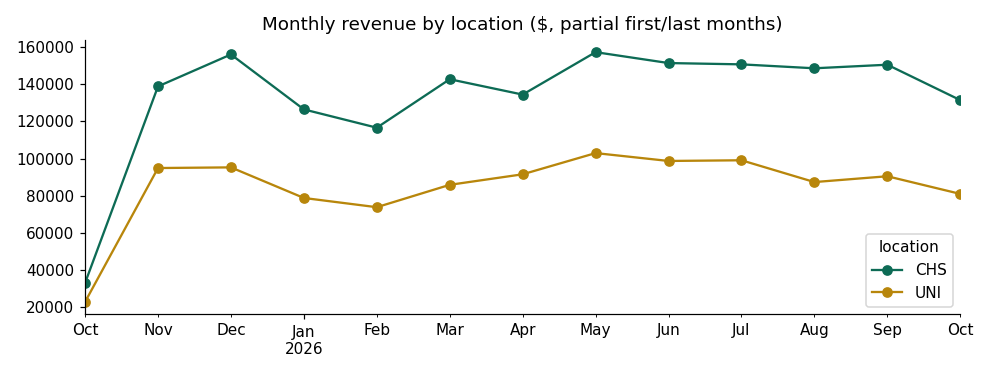
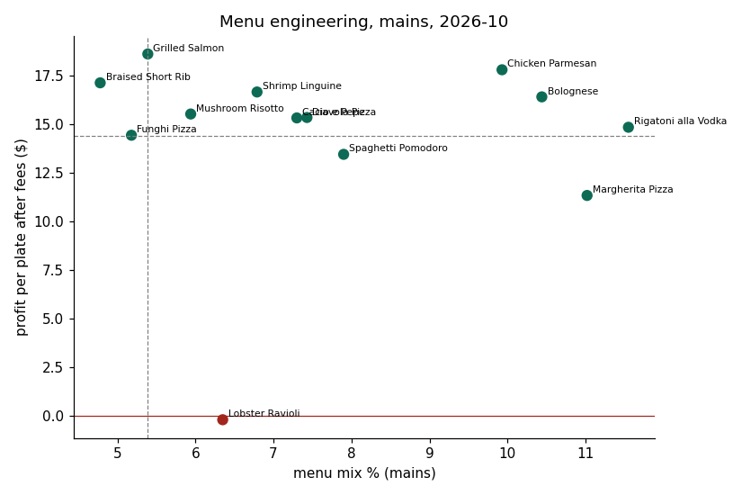
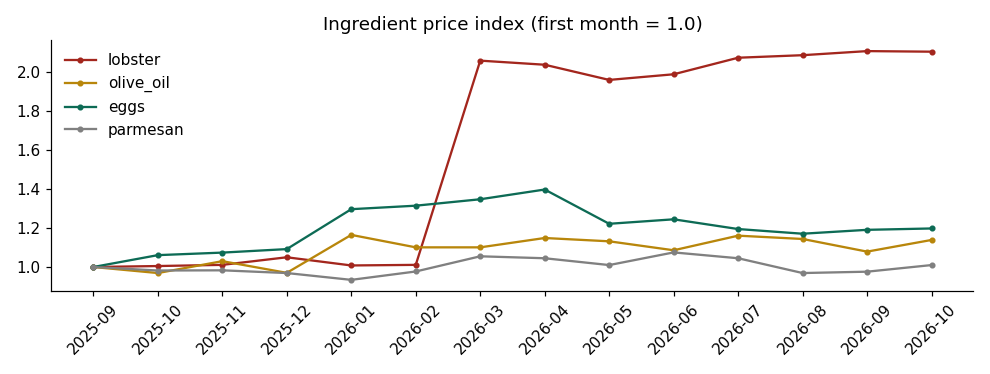
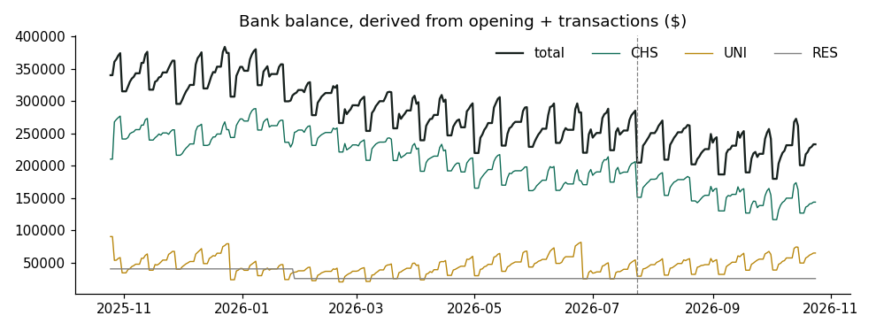

# Back of House: EDA (SIMULATED data)

Bank window 2025-10-25 to 2026-10-24. Backtest trains through 2026-07-24.

## 1. Integrity checks

| check                                  | pass   |
|:---------------------------------------|:-------|
| invoice total = sum of lines           | True   |
| invoice line = qty x unit price (+-1c) | True   |
| ticket gross = sum of lines            | True   |
| subtotal = gross - discount            | True   |
| bank dates inside window               | True   |
| bank amounts positive integers         | True   |
| bank ids unique                        | True   |
| every bank row categorized             | True   |
| no payroll dated after window in books | True   |
| no grader columns in bank feed         | True   |
| no negative daily balance              | True   |

Lowest daily balance by account ($): {'CHS': 116259, 'UNI': 19836, 'RES': 25000}

## 2. Revenue and operations

| location   |   avg_daily_rev |   covers |   delivery_share |   rev_per_labor_hr |   covers_per_seat |
|:-----------|----------------:|---------:|-----------------:|-------------------:|------------------:|
| CHS        |         4789.54 |   112.14 |             0.15 |              80.08 |              1.87 |
| UNI        |         3543.77 |    84.3  |             0.15 |              78.65 |              1.87 |

Dine-in check per cover ($):

| location   |   dinner |   lunch |
|:-----------|---------:|--------:|
| CHS        |    47.78 |   31.85 |
| UNI        |    47.97 |   31.84 |

Average revenue by weekday ($):

| dow   |   CHS |   UNI |
|:------|------:|------:|
| Mon   |  3351 |   nan |
| Tue   |  3533 |  2584 |
| Wed   |  4017 |  3022 |
| Thu   |  4407 |  3255 |
| Fri   |  6220 |  4219 |
| Sat   |  6855 |  4502 |
| Sun   |  5088 |  3653 |

Labor hours vs covers correlation: {'CHS': 0.93, 'UNI': 0.9} (staff are scheduled from a forecast, then cut or called in).

## 3. Monthly P&L (accrual) vs NRA benchmarks

| month   |   revenue_$ |   cogs_% |   labor_excl_tips_% |   occupancy_% |   net_cash_$ |
|:--------|------------:|---------:|--------------------:|--------------:|-------------:|
| 2025-10 |     55641.9 |    0.306 |               0.862 |         0.286 |    -25019.7  |
| 2025-11 |    233777   |    0.302 |               0.405 |         0.068 |    -19459.1  |
| 2025-12 |    251349   |    0.304 |               0.366 |         0.063 |     57345.1  |
| 2026-01 |    205239   |    0.304 |               0.443 |         0.077 |    -35828.2  |
| 2026-02 |    190396   |    0.309 |               0.467 |         0.084 |    -23640.7  |
| 2026-03 |    228586   |    0.33  |               0.398 |         0.07  |     14772.4  |
| 2026-04 |    225986   |    0.331 |               0.41  |         0.072 |    -11772.6  |
| 2026-05 |    260295   |    0.321 |               0.54  |         0.062 |    -67385    |
| 2026-06 |    250172   |    0.326 |               0.383 |         0.065 |     27026.3  |
| 2026-07 |    249839   |    0.325 |               0.388 |         0.065 |     -5705.99 |
| 2026-08 |    235970   |    0.325 |               0.406 |         0.069 |     -1472.34 |
| 2026-09 |    241030   |    0.326 |               0.394 |         0.067 |      7808.43 |
| 2026-10 |    212435   |    0.33  |               0.455 |         0.076 |    -23736.3  |

Full months only:

| metric                          |   ours |   NRA median (full-service) |
|:--------------------------------|-------:|----------------------------:|
| food & bev cost (COGS)          |  0.318 |                       0.32  |
| payroll + benefits (excl. tips) |  0.418 |                       0.365 |
| occupancy                       |  0.069 |                       0.06  |
| net cash margin                 | -0.038 |                       0.028 |

Labor is accrued on pay date; May 2026 has three paydays, so its labor % is a cash-timing spike, not a rate change. First and last months are partial.

## 4. Menu economics

| item                      | course   |   avg_price 2025-11 |   avg_price 2026-10 |   cm_per_plate 2025-11 |   cm_per_plate 2026-10 |   plate_cost 2025-11 |   plate_cost 2026-10 |
|:--------------------------|:---------|--------------------:|--------------------:|-----------------------:|-----------------------:|---------------------:|---------------------:|
| Arancini                  | starter  |               14.36 |               14.32 |                   9.48 |                   9.25 |                 4.1  |                 4.33 |
| Bolognese                 | main     |               25.5  |               26.38 |                  15.79 |                  16.39 |                 8.21 |                 8.55 |
| Bottle of Wine            | bottle   |               56.38 |               56.45 |                  32.08 |                  32.44 |                22.58 |                22.29 |
| Braised Short Rib         | main     |               37.26 |               36.88 |                  17.59 |                  17.11 |                17.37 |                17.82 |
| Burrata & Heirloom Tomato | starter  |               17.32 |               17.27 |                   9.85 |                   9.66 |                 6.64 |                 6.84 |
| Cacio e Pepe              | main     |               22.8  |               22.44 |                  15.69 |                  15.31 |                 5.75 |                 5.92 |
| Caesar Salad              | starter  |               14.31 |               15.26 |                   9.46 |                  10.11 |                 4.11 |                 4.42 |
| Chicken Parmesan          | main     |               27.54 |               28.12 |                  17.44 |                  17.78 |                 8.46 |                 8.93 |
| Cocktail                  | drink    |               15    |               15    |                  12.42 |                  12.18 |                 2.12 |                 2.36 |
| Diavola Pizza             | main     |               22.56 |               22.5  |                  15.59 |                  15.33 |                 5.7  |                 5.92 |
| Draft Beer                | drink    |                9    |                9    |                   7.33 |                   7.34 |                 1.4  |                 1.39 |
| Espresso                  | drink    |                4.5  |                4.5  |                   3.71 |                   3.65 |                 0.65 |                 0.71 |
| Funghi Pizza              | main     |               21.69 |               21.63 |                  14.86 |                  14.42 |                 5.59 |                 5.94 |
| Garlic Bread              | starter  |                9.26 |                9.13 |                   7.05 |                   6.98 |                 1.71 |                 1.76 |
| Grilled Salmon            | main     |               33.09 |               32.98 |                  19.33 |                  18.59 |                11.82 |                12.49 |
| House Wine (glass)        | drink    |               14    |               14    |                  10.11 |                  10.02 |                 3.46 |                 3.55 |
| Lobster Ravioli           | main     |               27.42 |               27.07 |                  11.84 |                  -0.18 |                14.05 |                25.8  |
| Margherita Pizza          | main     |               17.52 |               17.41 |                  11.65 |                  11.33 |                 4.9  |                 5.23 |
| Mushroom Risotto          | main     |               24.43 |               24.18 |                  15.54 |                  15.51 |                 7.45 |                 7.5  |
| Panna Cotta               | dessert  |               11.21 |               11.18 |                   8.24 |                   8.33 |                 2.42 |                 2.34 |
| Rigatoni alla Vodka       | main     |               21.6  |               21.58 |                  14.8  |                  14.83 |                 5.58 |                 5.58 |
| Shrimp Linguine           | main     |               28.59 |               28.02 |                  17.24 |                  16.64 |                 9.61 |                 9.95 |
| Soda                      | drink    |                4.6  |                4.58 |                   3.91 |                   3.88 |                 0.43 |                 0.46 |
| Spaghetti Pomodoro        | main     |               20.66 |               20.41 |                  13.89 |                  13.44 |                 5.66 |                 5.88 |
| Tiramisu                  | dessert  |               12.29 |               13.26 |                   8.54 |                   9.38 |                 3.14 |                 3.25 |

Lobster Ravioli by month:

| month   |   avg_price |   plate_cost |   cm_per_plate |   units |
|:--------|------------:|-------------:|---------------:|--------:|
| 2025-10 |       27.77 |        13.94 |          12.07 |      88 |
| 2025-11 |       27.42 |        14.05 |          11.84 |     328 |
| 2025-12 |       27.68 |        14.4  |          11.73 |     361 |
| 2026-01 |       27.37 |        14.07 |          11.72 |     338 |
| 2026-02 |       27.62 |        14.16 |          11.79 |     292 |
| 2026-03 |       27.43 |        25.48 |           0.44 |     341 |
| 2026-04 |       27.18 |        25.3  |           0.49 |     331 |
| 2026-05 |       27.49 |        24.34 |           1.59 |     373 |
| 2026-06 |       27.24 |        24.63 |           1.25 |     385 |
| 2026-07 |       27.14 |        25.49 |           0.25 |     336 |
| 2026-08 |       27.53 |        25.64 |           0.47 |     362 |
| 2026-09 |       27.33 |        25.88 |           0    |     343 |
| 2026-10 |       27.07 |        25.8  |          -0.18 |     299 |

Menu-engineering classes, last month:

| item                      | course   | menu_class   |   units |   food_cost_pct |   loses_money |
|:--------------------------|:---------|:-------------|--------:|----------------:|--------------:|
| Panna Cotta               | dessert  | plowhorse    |     385 |           0.209 |             0 |
| Tiramisu                  | dessert  | star         |     571 |           0.245 |             0 |
| Draft Beer                | drink    | dog          |     552 |           0.154 |             0 |
| Espresso                  | drink    | plowhorse    |     627 |           0.158 |             0 |
| Soda                      | drink    | plowhorse    |    1144 |           0.1   |             0 |
| Cocktail                  | drink    | star         |     667 |           0.157 |             0 |
| House Wine (glass)        | drink    | star         |    1413 |           0.254 |             0 |
| Lobster Ravioli           | main     | plowhorse    |     299 |           0.953 |             1 |
| Margherita Pizza          | main     | plowhorse    |     519 |           0.3   |             0 |
| Spaghetti Pomodoro        | main     | plowhorse    |     372 |           0.288 |             0 |
| Braised Short Rib         | main     | puzzle       |     225 |           0.483 |             0 |
| Funghi Pizza              | main     | puzzle       |     244 |           0.275 |             0 |
| Bolognese                 | main     | star         |     492 |           0.324 |             0 |
| Cacio e Pepe              | main     | star         |     344 |           0.264 |             0 |
| Chicken Parmesan          | main     | star         |     468 |           0.318 |             0 |
| Diavola Pizza             | main     | star         |     350 |           0.263 |             0 |
| Grilled Salmon            | main     | star         |     254 |           0.379 |             0 |
| Mushroom Risotto          | main     | star         |     280 |           0.31  |             0 |
| Rigatoni alla Vodka       | main     | star         |     544 |           0.259 |             0 |
| Shrimp Linguine           | main     | star         |     320 |           0.355 |             0 |
| Garlic Bread              | starter  | plowhorse    |     475 |           0.193 |             0 |
| Arancini                  | starter  | star         |     403 |           0.302 |             0 |
| Burrata & Heirloom Tomato | starter  | star         |     459 |           0.396 |             0 |
| Caesar Salad              | starter  | star         |     519 |           0.29  |             0 |

## 5. Ingredient prices

| ingredient   |   index_vs_first |
|:-------------|-----------------:|
| lobster      |            2.106 |
| eggs         |            1.198 |
| olive_oil    |            1.139 |
| potato       |            1.126 |
| tomato       |            1.115 |
| ground_beef  |            1.113 |

## 6. Cash

Cash on 2026-10-24: **$232,932**. Net cash over the window: **$-107,068**. See scenario_check.py for the forward view.

## 7. Bank feed by Nessie type and category

| nessie_type   | category                |   rows |   total_usd |
|:--------------|:------------------------|-------:|------------:|
| deposit       | Internal                |      4 |      122000 |
| deposit       | Sales - Card            |    672 |     2727682 |
| deposit       | Sales - Cash            |    204 |      229208 |
| deposit       | Sales - Delivery        |    208 |      351977 |
| deposit       | Supplier Credit         |      1 |          95 |
| purchase      | Beverage                |    104 |      159811 |
| purchase      | Direct Operating        |     48 |      108682 |
| purchase      | Food Supply - Dairy     |    207 |      246898 |
| purchase      | Food Supply - Dry Goods |    101 |      148054 |
| purchase      | Food Supply - Produce   |    249 |       74662 |
| purchase      | Food Supply - Protein   |    208 |      267235 |
| purchase      | G&A                     |     15 |       18415 |
| purchase      | Insurance               |     12 |       29400 |
| purchase      | Marketing               |     12 |       34000 |
| purchase      | Occupancy               |     24 |      192774 |
| purchase      | Repairs & Maintenance   |     46 |       17764 |
| purchase      | Software                |     25 |        4309 |
| purchase      | Utilities               |     96 |       96223 |
| withdrawal    | Chargeback              |      2 |         383 |
| withdrawal    | Debt Service            |     12 |       39000 |
| withdrawal    | Internal                |      4 |      122000 |
| withdrawal    | Labor                   |     52 |     1667612 |
| withdrawal    | Owner Draw              |     12 |      120000 |
| withdrawal    | Sales Tax               |     11 |      190807 |
